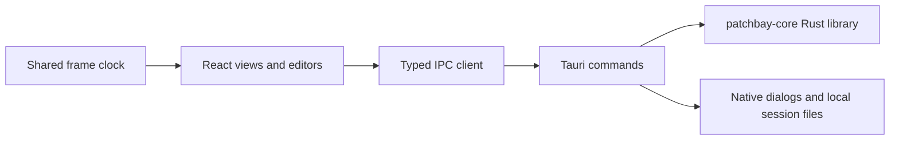

# Architecture

Patchbay has three runtime boundaries: React presents the workbench, a Tauri host
handles desktop operations, and `patchbay-core` implements machine behavior.

## Domain ownership

`crates/patchbay-core` has no UI or Tauri dependency. It owns parsing and
serialization, input tokenization, complete-machine validation, simulation,
Mealy/Moore conversion, presets, graph validation and immutable graph edits.
`execute(DomainRequest)` returns a tagged response or a structured error.

`src/domain/contracts.ts` mirrors the Rust serde DTOs.
`src/domain/client.ts` is the frontend's domain and desktop gateway. The request
and response unions name actual operations; UI code does not parse definitions,
simulate machines or validate graph semantics. The browser-only preview reports
an unavailable desktop backend. Tests may supply an explicit harness backend.

Legacy TypeScript engine/editor sources remain as compatibility references and
test oracles. The production entrypoint is `src/main.tsx`; it mounts React with
`createRoot` and does not mount the previous string-template application.

## React state and asynchronous work

`src/app/state.ts` defines workbench state, reducer operations and a synchronous
store exposed to React through `useSyncExternalStore`. `use-workbench.ts` owns
user actions and IPC sequencing. Views in `src/components` render that state;
the editor consumes a typed props contract in `src/editor/contracts.ts`.

Graph edits are serialized through a queue. Generation counters reject stale
parse, conversion, graph and startup results. Manual text validation is debounced;
unfinished text remains distinct from the last valid machine. Undo and redo hold
up to 50 graph snapshots. Closing the native window flushes pending operations
and session writes before allowing the window to close.

Drawing handles emit the existing Rust `upsertTransition` command. The frontend
chooses a default label from unused alphabet inputs, while Rust remains the
authoritative validator. Existing state/input pairs require deliberate editing.

`SessionWriter` serializes persistence requests and surfaces save failures.
`src-tauri/src/session.rs` validates session content, performs atomic saves and
preserves invalid or unsupported session bytes before recovery. The previous
Electron LevelDB profile is read through a copied snapshot; the original profile
is not modified by import.

Atomic save and recovery code resolves the newly created temporary file's physical
location before renaming it beside that file. Windows packaged launchers can
leave an existing AppData parent on one drive while redirecting new children to
another. Resolving the parent alone therefore does not suffice. Publication stays
atomic and the resulting file is accessible through the original logical path;
normal unpackaged launches use the ordinary AppData directory. See the official
[Windows AppData virtualization behavior](https://learn.microsoft.com/en-us/windows/msix/desktop/desktop-to-uwp-behind-the-scenes#appdata-operations-on-windows-10-version-1903-and-later)
and [Rust canonicalize implementation](https://doc.rust-lang.org/std/fs/fn.canonicalize.html).

## Desktop commands and files

`src-tauri/src/commands.rs` exposes six app operations: domain work, startup,
session save, project open, project save and own-window screenshot. Native
dialogs choose project paths. The command boundary checks the main-window label,
applies resource limits and runs blocking domain/file work on worker tasks.

`src-tauri/capabilities/main.json` grants those operations and the window controls
needed by the custom chrome. There is no general-purpose frontend filesystem,
shell or HTTP plugin. The production CSP permits bundled assets and local Tauri
IPC. Fonts, renderer assets and notices are packaged locally.

Screenshot capture runs a short-lived copy of the executable in a private capture
mode, returning PNG bytes to the parent before the save dialog opens. This keeps
the app event loop responsive and works around [xcap's deliberate exclusion of
the current process](https://docs.rs/crate/xcap/0.9.8/source/src/windows/impl_window.rs).
The frontend cannot supply a capture target, shell command or arbitrary output path.

Sessions use Tauri's application data directory:
`%APPDATA%\io.patchbay.studio\session.json` on Windows. Debug native tests can use
`PATCHBAY_TEST_DATA_DIR`; that override is excluded from release builds. Recovery
and migration tests use isolated temporary directories.

## Rendering and motion

`src/rendering/frame-clock.ts` is the shared requestAnimationFrame owner and the
only rAF loop in the app. Playback, the diagram and graph canvases, the field and
the theme wave's foam subscribe and release their own lifetimes. DOM updates
show the active state, while viewport-sized Canvas2D layers draw diagram ink.
Resize observers update canvas geometry. The editor owns hit testing, drag/connect
gestures, camera transforms and selection; Rust owns the resulting graph changes.

`src/playback` controls stepping, seeking and travel timing from a Rust trace.
Tape cells and trace rows are windowed to bound DOM growth. Hidden windows pause
the clock. Local p50/p95 and long-frame readings are session diagnostics, rather
than a fixed-refresh performance promise.

### Frame rate and display detection

Animation is paced by the display. `requestAnimationFrame` is vsync-aligned in
WebView2, and the clock dispatches to its subscribers on every vsync while
Settings › Frame rate is _Match display_. The fixed 60 and 30 fps power savers
decimate on vsync boundaries. Pure pacing and dynamic-resolution rules live in
`src/rendering/pacing.ts`. There are no fixed frame caps and no timer-driven
animation; compositor animations (the launch, the wave edge, springs, WAAPI) are
paced by Chromium at the display rate.

`src-tauri/src/display.rs` reads the refresh rate of the monitor the window is on
through Win32: `MonitorFromWindow` → `GetMonitorInfoW` (device name) →
`EnumDisplaySettingsW(ENUM_CURRENT_SETTINGS).dmDisplayFrequency`. For a
variable-refresh panel this is the mode's maximum; a reported 0 or 1 means
unknown. The value travels in the Startup payload (`display: { refreshHz, source,
device }`), through the `display_refresh` command, and as a `display-refresh` event
when the window moves to another monitor, its scale factor changes or it regains
focus after a mode change. `src/rendering/display.ts` feeds it to the clock. The
clock also measures rAF intervals (`signals.refreshHz`), cross-checks them against
the detected rate, and records any persistent mismatch as a diagnostics note;
pacing always follows the real vsync. The page exposes `html[data-display-hz]`
and `html[data-fps]`.

The field trades resolution, never frames. Quality tiers set the base render
scale. When the 90th-percentile frame gap exceeds 1.2× the target, the field
lowers a dynamic scale (floor 0.5×) and raises it again after sustained headroom.
Only at the floor does it step down a tier. Warm-up, the launch and the wave are
excluded from that sampling. Each step's reason is published in `html[data-bg-reason]`
and Settings › Local diagnostics. A motionless field unsubscribes and draws no
frames.

`src/reference.css` holds the two themes of the Night & Pearl design
(see `DESIGN.md`): `:root` and `html[data-theme='dark']` are Night (default),
`html[data-theme='light']` is Pearl. Both themes define the same tokens: opaque
reading plates, three text inks (`--silk`, `--muted`, `--faint`), one accent per
theme (`--brand`: pistachio in Night, PlayStation-style blue in Pearl), neutral
selection (`--select`, white in Night and black in Pearl) and a themed
instrument plate (`--panel-*`). The live signal is `--panel-signal` with
`--signal-glow`; the only other hues are a muted rose for faults and the
window-close red. No colour literal lives outside `reference.css`. The diagram
and graph canvases read `--panel-ink`, `--panel-ring`, `--panel-signal` and
`--panel-line`, and re-read them and redraw on every `html[data-theme]` change.
The field takes its palette from `src/rendering/field/palette.ts`. Text uses
local Inter Variable through `--display`. Large page titles use Newsreader 400
through `--serif`. Tape symbols, labels and code use IBM Plex Mono through
`--mono`.

### Launch

Rust chooses the launch before the window exists. `src-tauri/src/launch.rs`
reads a lenient hint from `session.json` (theme, launch animation, launch seen,
reduced motion, high contrast, quality) and picks `off`, `full`, `short` or
`still`. The debug-only `PATCHBAY_LAUNCH` overrides it. Debug runs with
`PATCHBAY_TEST_DATA_DIR` default to off. `appearance.rs` passes
`launch-init.js` to the window as an initialization script. WebView2 runs it at
document creation on every navigation, before any page script. It sets
`html[data-theme]` and `html[data-launch]`, exposes `window.__patchbayBoot`, and
installs capture-phase, passive listeners that skip the launch on the first key,
pointer press, wheel or touch without consuming the event. The window's
background colour and native theme are the persisted theme's mask, so no frame
shows the other theme.

The stage and its CSS are inline in `index.html` (`<style id="launch-css">`,
`
` before `#app`). Only `transform` and `opacity` animate, on
the compositor, while the bundle loads. `src/launch/launch.ts` dispatches
`patchbay:launch-handoff` (the Bench replays its build) and `patchbay:launch`
when done, removes the stage, and lets the app record `launchSeen`.
`html[data-capture]` and forced colours hide the stage.

### Theme wave

`src/motion/theme-wave.ts` switches themes inside `document.startViewTransition`.
The update callback commits the theme synchronously (`flushSync`), snaps the
field to the new palette and redraws the canvases, so the new snapshot is fully
themed. A WAAPI `clip-path: path()` animation on `::view-transition-new(root)`,
with keyframes that share one command list, moves the wave's edge on the
compositor. A foam canvas, attached only during the wave, draws on the frame
clock. The native window theme (`setTheme`, which also sets the Mica tint) is
applied only after the transition finishes; meanwhile the Mica frame paints the
solid mask. A second press reverses the wave. Any other pointer press, key or
wheel ends it and is delivered. Reduced motion uses a 160 ms cross-fade.
`html[data-capture]`, `html[data-theme-instant]` (tests), forced colours and
missing View Transition support switch instantly.

### The field

`src/components/FieldCanvas.tsx` renders `<canvas id="field">` as the sibling
before `.react-app`: fixed, full-window, `aria-hidden`, unfocusable and
`pointer-events: none`. `src/rendering/field/` is a hand-written WebGL2 renderer
with no 3D library. It draws one graphite jack per state and one sagging cable
per state pair from `buildDiagram`. A socket floor is lit by a key light that
follows the cursor. A composite pass frosts, lens-bends and luminance-clamps the
scene under the registered glass (title bar, sidebar, docked sheet). It caps the
field's luminance everywhere else. The field reads playback from the player each
frame instead of through React state. It subscribes to the shared frame clock
only while something moves, and then stops and keeps its last frame.

The field writes `html[data-bg=webgl|static|off]`, `data-bg-scale`,
`data-bg-fps`, `data-bg-reason`, `data-window` and `#debug.background`. Settings
shows the same status as `#metric-background`. The mode is `off` under reduced transparency,
high contrast or forced colors. It is `static` (a CSS gradient, no WebGL
context) at low quality, without WebGL2, after two context losses, or when the
startup auto-tier finds slow frames. Otherwise it is `webgl`. Reduced motion
keeps a still frame. `PATCHBAY_OPAQUE` does not change the mode, because the
field is opaque. Screenshots set `html[data-capture]`, which hides the canvas so
captures stay deterministic.

### Motion

`src/motion/spring.ts` derives critically damped and lightly bouncy springs
from Apple's duration and bounce parameters. `springs.css` bakes them into
`linear()` easings. `UIMotion` retargets page and drawer transitions from the
presented value, so they can be interrupted. Keyboard routes, playback steps,
typing and editor drags are never animated or delayed. Reduced motion turns
route and sheet changes into a short opacity crossfade.

Custom SVG navigation sits in a grouped sidebar: Bench, Machines, Editor and
Learn, then the Trace, Text definition and Settings panels. One indicator
moves between rows.
Side panels use non-modal dialogs, preserving the current page and usable
navigation. Their focus and Escape behavior stay within React's lifecycle.
Frame diagnostics subscribe only while Settings is mounted, avoiding unrelated
once-per-second application and graph reconciliation while idle.
Reduced motion honors both the operating system and the application preference.

## Window material

Transparency is fixed when a Tauri window is created, so `src-tauri/src/appearance.rs`
builds the main window itself (`create: false` in `tauri.conf.json`). On Windows 11
(build 22000 or later) and without `PATCHBAY_OPAQUE`, it creates a transparent
window and applies Mica through `window-vibrancy`, keeping the result. Otherwise
the window is an ordinary opaque one. The startup payload reports
`backdrop: { kind: 'mica' | 'none', reason }`.

`src/app/use-visual-system.ts` sets `html[data-backdrop='mica']` only when Rust
reports Mica, the persisted `glass` preference (**Window material**) is on, and
neither high contrast nor reduced transparency is requested; otherwise the page
uses `data-backdrop='solid'` and paints the frame with the opaque `--mask`. Under
Mica `body` carries a translucent tint; the field canvas normally covers it.
Session files are version 2. Version 1 sessions stored a `solid` glass value that
the old frontend forced, so `session.rs` loads them with `glass: 'baked'` once.

Liquid Glass is the navigation layer only, and glass never contains glass. The
title bar, the sidebar (a bottom tab bar at 719px and narrower) and the drawer
docked at 1200px and wider sit over the field only. Below 1200px the drawer is
a solid, non-modal overlay. Under `html[data-bg=webgl]` the shader draws their
frost, so their CSS `backdrop-filter` is `none`. Under `static` they use their
`--glass-filter-*` blur. The toast, the scrolled Machines heading and the tape
overflow cells float over content and keep small CSS blurs. Those six surfaces
are the complete backdrop-filter allow-list. Reduced transparency, low quality,
high contrast, forced colors and screenshots make every one of them solid. The
sheet, dock, editor, cards and the instrument plate stay opaque. No glass may
overlap `.patch-panel`, `#diagram` or `.graph-stage`. The window theme follows
the app theme through `setTheme`, which also sets the Mica tint; after a theme
wave it is set only once the transition has finished. Screenshots set
`html[data-capture]` so the page paints opaque, and the capture helper flattens
any remaining alpha over the page color.

## Resource limits

The core bounds project text to 1 MiB UTF-8 and input to 4,096 UTF-16 units.
Machine/draft DTOs and IPC JSON use a 16 MiB budget. Trace, conversion and fill
operations charge allocation growth. Diagnostics cap messages and message length.
These bounds protect resource use without imposing an arbitrary state count.

## Build and distribution

Vite builds the renderer into `dist`; Tauri embeds those assets in the executable.
The release uses the separately installed WebView2 Evergreen Runtime. The NSIS
installer is per user and skips runtime download; the preinstall hook explains a
missing runtime and exits.

`scripts/distribute.mjs` checks matching npm/Tauri/Rust package versions, generates
local dependency notices, builds with the Cargo lockfile, and rejects source
changes during the build. `package.mjs` creates a portable folder, deterministic
ZIP, installer copy, source manifest and SHA-256 inventory. It overwrites only its
known artifact names and rejects unexpected files rather than deleting a release
directory recursively.

`check-package.mjs` verifies the full artifact inventory, hashes, Windows x64 PE
header, resources and ZIP contents. Its optional `--current-source` mode also
checks source hashes and equality with the current native release executable;
the distribution pipeline always uses that strict mode. Installation and real
application behavior need separate lifecycle verification.

The renderer audit retains a 150,000-byte gzipped JavaScript budget. Its total
asset budget was raised from 400,000 to 512,000 bytes after the React migration
measured 428,052 bytes with the fonts and license of that time. The Lumen
redesign raised it once more, to 544,000 bytes: the WebGL2 field renderer and
Inter Variable replace IBM Plex Sans, with no 3D library (three.js measured about
1 MB). Night & Pearl raised it a third time (2026-10-30), to the measured build
plus 6 KB, capped at 600,000 bytes. That covers the user-pinned serif, Newsreader
400 (22,480-byte WOFF2 and its 4,520-byte OFL text), the theme wave, the inline
launch CSS and native-refresh pacing, with no library added. The justification
is recorded in `scripts/check-bundle.mjs` and `docs/verification.md`. These are
size guards; they do not establish runtime speed or a refresh-rate guarantee. The current measurements are recorded in `artifacts/bundle-report.json`.
