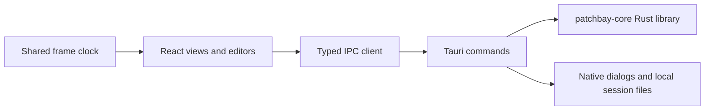

# Architecture

Patchbay has three runtime boundaries: React presents the workbench, a Tauri host
handles desktop operations, and `patchbay-core` implements machine behavior.

## Domain ownership

`crates/patchbay-core` has no UI or Tauri dependency. It owns parsing and
serialization, input tokenization, complete-machine validation, simulation,
Mealy/Moore conversion, presets, graph validation and immutable graph edits.
`execute(DomainRequest)` returns a tagged response or a structured error.

`src/domain/contracts.ts` mirrors the Rust serde DTOs.
`src/domain/client.ts` is the frontend's domain and desktop gateway. The request
and response unions name actual operations; UI code does not parse definitions,
simulate machines or validate graph semantics. The browser-only preview reports
an unavailable desktop backend. Tests may supply an explicit harness backend.

Legacy TypeScript engine/editor sources remain as compatibility references and
test oracles. The production entrypoint is `src/main.tsx`; it mounts React with
`createRoot` and does not mount the previous string-template application.

## React state and asynchronous work

`src/app/state.ts` defines workbench state, reducer operations and a synchronous
store exposed to React through `useSyncExternalStore`. `use-workbench.ts` owns
user actions and IPC sequencing. Views in `src/components` render that state;
the editor consumes a typed props contract in `src/editor/contracts.ts`.

Graph edits are serialized through a queue. Generation counters reject stale
parse, conversion, graph and startup results. Manual text validation is debounced;
unfinished text remains distinct from the last valid machine. Undo and redo hold
up to 50 graph snapshots. Closing the native window flushes pending operations
and session writes before allowing the window to close.

Drawing handles emit the existing Rust `upsertTransition` command. The frontend
chooses a default label from unused alphabet inputs, while Rust remains the
authoritative validator. Existing state/input pairs require deliberate editing.

`SessionWriter` serializes persistence requests and surfaces save failures.
`src-tauri/src/session.rs` validates session content, performs atomic saves and
preserves invalid or unsupported session bytes before recovery. The previous
Electron LevelDB profile is read through a copied snapshot; the original profile
is not modified by import.

Atomic save and recovery code resolves the newly created temporary file's physical
location before renaming it beside that file. Windows packaged launchers can
leave an existing AppData parent on one drive while redirecting new children to
another. Resolving the parent alone therefore does not suffice. Publication stays
atomic and the resulting file is accessible through the original logical path;
normal unpackaged launches use the ordinary AppData directory. See the official
[Windows AppData virtualization behavior](https://learn.microsoft.com/en-us/windows/msix/desktop/desktop-to-uwp-behind-the-scenes#appdata-operations-on-windows-10-version-1903-and-later)
and [Rust canonicalize implementation](https://doc.rust-lang.org/std/fs/fn.canonicalize.html).

## Desktop commands and files

`src-tauri/src/commands.rs` exposes six app operations: domain work, startup,
session save, project open, project save and own-window screenshot. Native
dialogs choose project paths. The command boundary checks the main-window label,
applies resource limits and runs blocking domain/file work on worker tasks.

`src-tauri/capabilities/main.json` grants those operations and the window controls
needed by the custom chrome. There is no general-purpose frontend filesystem,
shell or HTTP plugin. The production CSP permits bundled assets and local Tauri
IPC. Fonts, renderer assets and notices are packaged locally.

Screenshot capture runs a short-lived copy of the executable in a private capture
mode, returning PNG bytes to the parent before the save dialog opens. This keeps
the app event loop responsive and works around [xcap's deliberate exclusion of
the current process](https://docs.rs/crate/xcap/0.9.8/source/src/windows/impl_window.rs).
The frontend cannot supply a capture target, shell command or arbitrary output path.

Sessions use Tauri's application data directory:
`%APPDATA%\io.patchbay.studio\session.json` on Windows. Debug native tests can use
`PATCHBAY_TEST_DATA_DIR`; that override is excluded from release builds. Recovery
and migration tests use isolated temporary directories.

## Rendering and motion

`src/rendering/frame-clock.ts` is the shared requestAnimationFrame owner. Playback,
diagram and graph canvases subscribe and release their own lifetimes. DOM updates
show the active state, while viewport-sized Canvas2D layers draw diagram ink.
Resize observers update canvas geometry. The editor owns hit testing, drag/connect
gestures, camera transforms and selection; Rust owns the resulting graph changes.

`src/playback` controls stepping, seeking and travel timing from a Rust trace.
Tape cells and trace rows are windowed to bound DOM growth. Hidden windows pause
the clock. Local p50/p95 and long-frame readings are session diagnostics, rather
than a fixed-refresh performance promise.

The current app uses solid blue/red/white and dark grey/orange/lime palettes in
`src/reference.css`, local Nunito, custom SVG navigation and restrained DOM motion.
Side panels use non-modal dialogs, preserving the current page and usable
navigation. Their focus and Escape behavior stay within React's lifecycle.
Frame diagnostics subscribe only while Settings is mounted, avoiding unrelated
once-per-second application and graph reconciliation while idle.
The mounted app has no background scene or glass controls. Only the persisted
`glass` preference remains for saved-session compatibility; effective visual
settings force opaque surfaces. Reduced motion honors both the operating system
and the application preference.

## Resource limits

The core bounds project text to 1 MiB UTF-8 and input to 4,096 UTF-16 units.
Machine/draft DTOs and IPC JSON use a 16 MiB budget. Trace, conversion and fill
operations charge allocation growth. Diagnostics cap messages and message length.
These bounds protect resource use without imposing an arbitrary state count.

## Build and distribution

Vite builds the renderer into `dist`; Tauri embeds those assets in the executable.
The release uses the separately installed WebView2 Evergreen Runtime. The NSIS
installer is per user and skips runtime download; the preinstall hook explains a
missing runtime and exits.

`scripts/distribute.mjs` checks matching npm/Tauri/Rust package versions, generates
local dependency notices, builds with the Cargo lockfile, and rejects source
changes during the build. `package.mjs` creates a portable folder, deterministic
ZIP, installer copy, source manifest and SHA-256 inventory. It overwrites only its
known artifact names and rejects unexpected files rather than deleting a release
directory recursively.

`check-package.mjs` verifies the full artifact inventory, hashes, Windows x64 PE
header, resources and ZIP contents. Its optional `--current-source` mode also
checks source hashes and equality with the current native release executable;
the distribution pipeline always uses that strict mode. Installation and real
application behavior need separate lifecycle verification.

The renderer audit retains a 150,000-byte gzipped JavaScript budget. Its total
asset budget is 512,000 bytes, raised from the earlier 400,000-byte limit after
the React migration measured 428,052 bytes including the local font and license.
These are size guards; they do not establish runtime speed or a refresh-rate
guarantee. The current measurements are recorded in `artifacts/bundle-report.json`.
